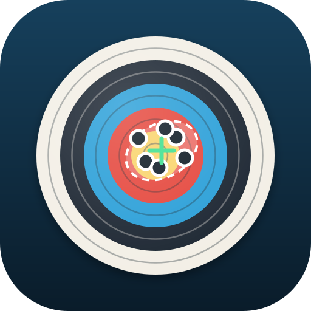

# ArrowPlot



Archery score keeping with arrow plotting, as an installable web app (PWA) for Android and iOS.
Inspired by [MyTargets](https://github.com/DreierF/MyTargets), and able to import its backups and
MantisX shot exports.

Live: **https://mrj9600.github.io/ArrowPlot/**

## Features

- **Your own rounds**: define rounds (one or more distances, face, scoring, ends) under Equipment, with a
  starter set (WA 18 m, 70 m, 1440, field, Vegas, …) you can edit or delete.
- **Trainings**: pick one of your rounds, bow and arrows; optional arrow numbering with the numbers you choose.
- **End input** by plotting arrows on the face (the point sits above your finger, with a live ring readout
  and zoom) or with ring buttons. Multi-spot faces follow the arrow order. Arrow numbering can be switched off mid-session.
- **Target faces** for WA full / 6 / 5 / 3 ring, vertical and Vegas 3-spot, Danage, WA and NFAA field,
  NFAA indoor, Worcester, 3D and animal rounds, with their scoring styles. Ring sizes are worked out from the
  face specifications; an arrow touching a line scores the higher ring. 3D and animal faces are drawn as
  simple stylised shapes.
- **Analysis** per round, training or any filtered set: group centre and offset with aim/sight advice,
  ±1 SD spread ellipse, R50/R90, mean radius, widest pair, score if the group were centred, arrows per
  ring, best-arrows averages. Trend charts of average per arrow and group size.
- **Equipment**: bows with type-specific tuning fields, sight marks and photo; arrow sets with diameter.
- **Shooting timer** with walk-up, warning and beeps; keeps the screen awake.
- **Import MyTargets backups** (`MyTargets_backup_*.zip` or a bare `data.db`): trainings, rounds, ends, shots,
  bows, sight marks, arrows, standard rounds and photos. Re-importing a newer backup only adds new trainings.
- **Import MantisX** shot exports (CSV): each session becomes a training, or gives arrow positions to a
  training entered as scores only on the same day with the same scores. Option to keep MantisX's score for
  arrows on a line.
- **Own backup/restore** (zip with JSON + photos) through the system share sheet or a download.
  Your data is never locked in.
- Works offline, light/dark theme, asks the browser for persistent storage.

## Where data is stored

Everything stays on the device, in the browser's IndexedDB for this site (via Dexie). Nothing is uploaded.
Clearing the site's data or uninstalling the app deletes it, so export a backup now and then
(More → Export backup). On iOS, add the app to the home screen: Safari may otherwise clear storage of sites
not used for a week.

## Development

```bash
npm install
npm start          # http://localhost:4200
npm run build      # production build in dist/ArrowPlot/browser
npm run icons      # regenerate all icons from tools/logo.svg
```

Code map:

- `src/app/core/targets.ts`: target faces and scoring
- `src/app/core/stats.ts`: group analysis
- `src/app/core/import/`: MyTargets (sql.js), MantisX (CSV) and ArrowPlot backup formats
- `src/app/pages/`: one standalone component per screen; `src/app/ui/`: shared components

## Deployment

`.github/workflows/deploy.yml` builds with `--base-href /ArrowPlot/` and publishes to GitHub Pages on every
push to `main`. One-time setup: push to `github.com/mrj9600/ArrowPlot`, then under **Settings → Pages** set
**Source** to **GitHub Actions**.

## License

MIT, see [LICENSE](LICENSE).

ArrowPlot is an independent project, not affiliated with MyTargets or MantisX. It reads their file formats
so you can bring your own data over. The target faces are written from the archery rules; to read
MyTargets backups they use the same target numbers and the same order of scoring zones and styles as
MyTargets. Icons are Material Symbols (Apache 2.0).
